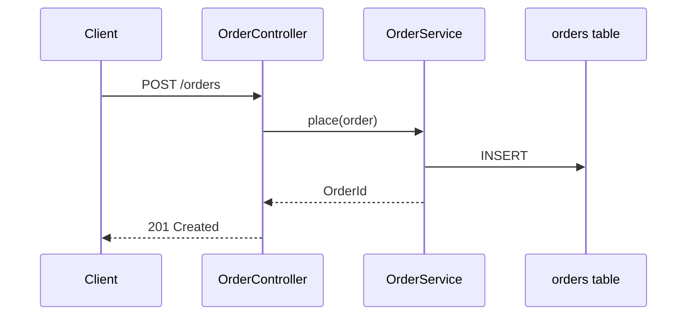

# Mermaid diagrams

Pick the diagram that answers one question:
| Question | Diagram |
|---|---|
| What are the parts and how do they connect? | `flowchart LR` |
| What happens, in which order, for a request? | `sequenceDiagram` |
| What is the data model? | `erDiagram` |
| What states can X be in? | `stateDiagram-v2` |
| What depends on what over time? | `gantt` / `timeline` |

## Rules
- One idea per diagram, <= ~15 nodes; split otherwise.
- Use real names from the code (module, class, table) so readers can find them.
- Label edges with the verb/protocol (`-- REST -->`, `-- publishes OrderPlaced -->`).
- Quote labels with special characters: `A["Order API (v2)"]`.
- Avoid styling/colours that break dark mode; let the renderer theme it.
- Validate by rendering (GitHub/GitLab preview or `npx @mermaid-js/mermaid-cli -i x.mmd -o x.svg`).

