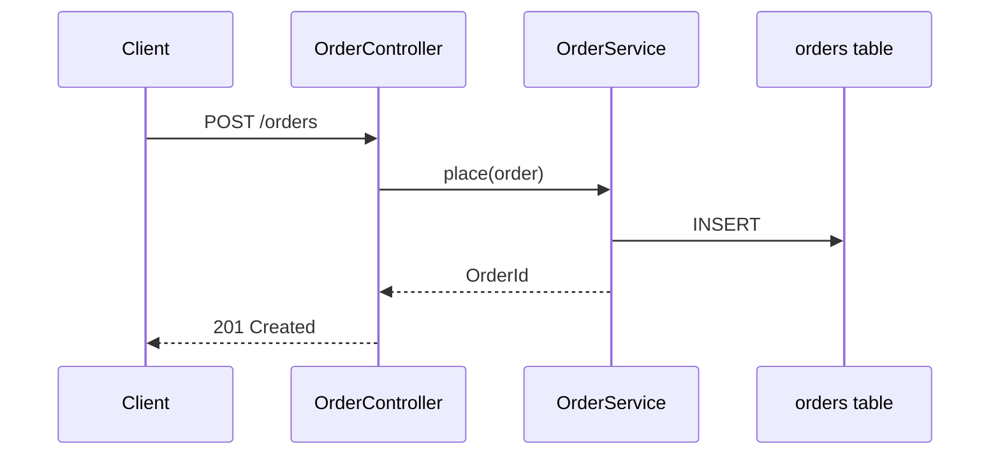

# Mermaid Diagrams

Draw one diagram per question, using names the reader can find in the code.

## Anti-Pattern: "The Whole System In One Picture"

A 40-node diagram answers no question and nobody updates it. One idea per diagram, split the rest.

## Checklist

1. **Context** - use real names from `docs/ai/context/ARCHITECTURE.md` / `SCHEMA.md` and the code
2. **Pick** the diagram that answers one question
3. **Draw** within the size limit
4. **Label** edges
5. **Validate** by rendering

## The Process

| Question | Diagram |
|---|---|
| What are the parts and how do they connect? | `flowchart LR` |
| What happens, in which order, for a request? | `sequenceDiagram` |
| What is the data model? | `erDiagram` |
| What states can X be in? | `stateDiagram-v2` |
| What depends on what over time? | `gantt` / `timeline` |

- One idea per diagram, <= ~15 nodes; split otherwise.
- Real names (module, class, table) so readers can find them.
- Label edges with the verb/protocol (`-- REST -->`, `-- publishes OrderPlaced -->`).
- Quote labels with special characters: `A["Order API (v2)"]`.
- No styling/colours that break dark mode; let the renderer theme it.
- Validate: GitHub/GitLab preview or `npx @mermaid-js/mermaid-cli -i x.mmd -o x.svg`.

## Key Principles

- One question, one diagram
- Real names from the code
- Labelled edges
- Rendered before committed

## Transition

Diagrams go into ARCHITECTURE.md / SCHEMA.md (`@documenter`) or ADRs (`technical-writing`).
